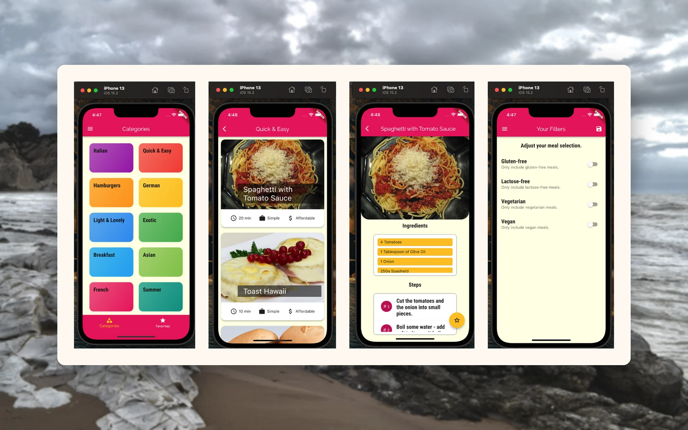
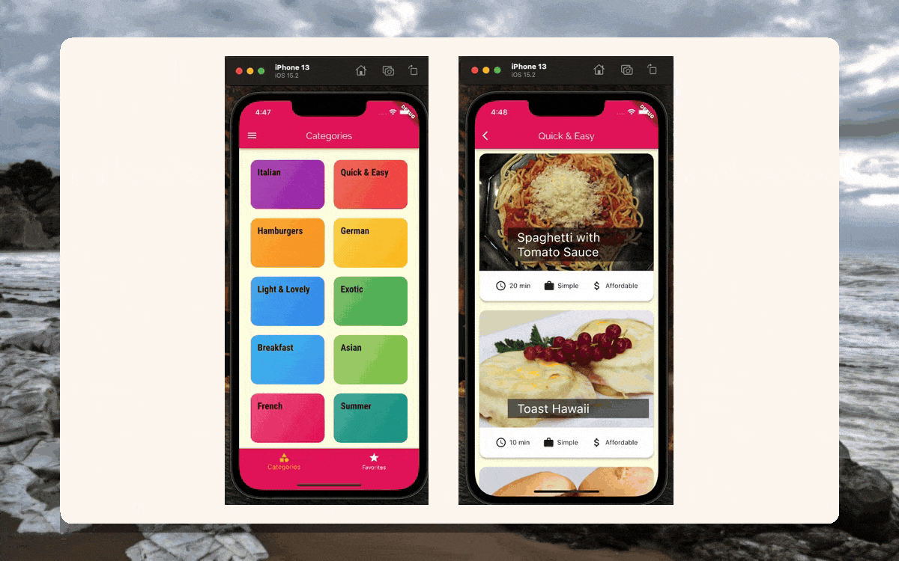
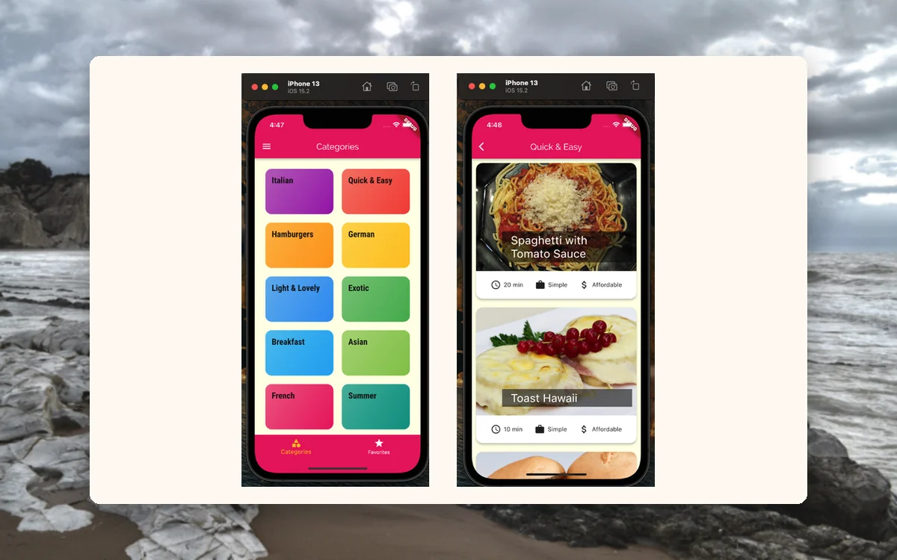
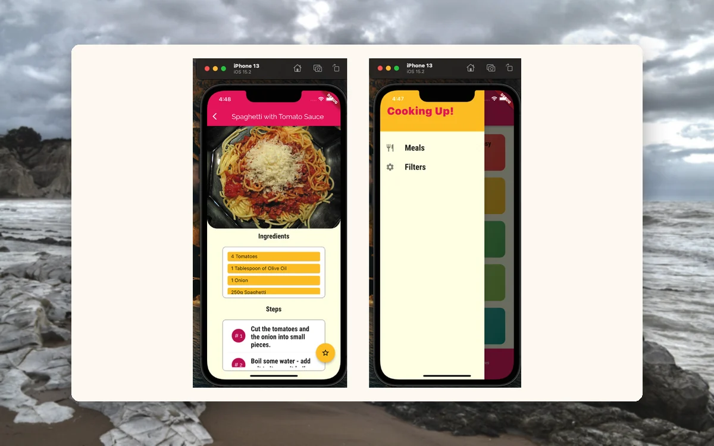
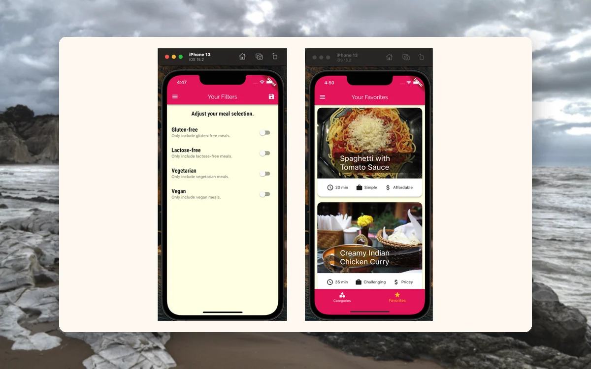
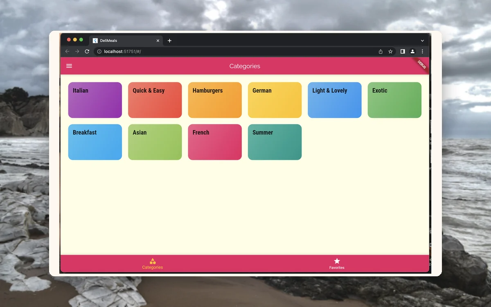

<p align="center">
  <picture>
    <source media="(prefers-color-scheme: dark)" srcset="docs/brand/svg/meals-logo-on-dark.svg">
    
  </picture>
</p>

<h1 align="center">Browse meals by category. Filter them by diet.</h1>

<p align="center">
  Coursework from 2022: a Flutter recipe app built while following a Flutter course.<br>
  <b>10 categories. 10 meals. Favorites and diet filters.</b>
</p>

<p align="center">
  
  
  
  
  <a href="https://github.com/mertkayacs/Flutter-Meals-App"></a>
</p>

<p align="center">
  <a href="#quick-start"></a>
  <a href="#a-quick-tour"></a>
  <a href="lib/main.dart"></a>
</p>

<p align="center">
  <picture>
    <source media="(prefers-color-scheme: dark)" srcset="docs/assets/readme/hero-dark.webp">
    
  </picture>
</p>

DeliMeals is a Flutter recipe app with ten food categories. You browse meals by category, open a recipe with ingredients and cooking steps, mark favorites and filter by diet. I built it in 2022 while following a Flutter course. All meal data is hardcoded in the app, so it needs no backend or API key.

---

## Why DeliMeals

The app is small and each screen has one job.

|  |  |
|---|---|
|  **Categories first** | The home screen shows ten category tiles. Each opens a list of meals with duration, complexity and affordability. |
|  **Favorites** | A star on the recipe page adds the meal to a favorites tab. |
|  **Diet filters** | Gluten-free, lactose-free, vegetarian and vegan switches change which meals show up. |
|  **Data in the app** | Ten meals and ten categories live in [lib/dummy_data.dart](lib/dummy_data.dart). Meal images load from remote URLs. |

## A quick tour

<p align="center">
  
</p>

<table>
  <tr>
    <td width="50%" valign="top">
      <picture>
        <source media="(prefers-color-scheme: dark)" srcset="docs/assets/readme/tour/categories-dark.webp">
        
      </picture>
      <h3>Categories and meals</h3>
      Ten category tiles lead to a list of meals with duration, complexity and cost.
    </td>
    <td width="50%" valign="top">
      <picture>
        <source media="(prefers-color-scheme: dark)" srcset="docs/assets/readme/tour/recipe-dark.webp">
        
      </picture>
      <h3>Recipe and drawer</h3>
      A meal page lists ingredients and steps, with a star button for favorites and a drawer for navigation.
    </td>
  </tr>
  <tr>
    <td width="50%" valign="top">
      <picture>
        <source media="(prefers-color-scheme: dark)" srcset="docs/assets/readme/tour/filters-dark.webp">
        
      </picture>
      <h3>Filters and favorites</h3>
      Switch on gluten-free, lactose-free, vegetarian or vegan. Favorites collect in their own tab.
    </td>
    <td width="50%" valign="top">
      <picture>
        <source media="(prefers-color-scheme: dark)" srcset="docs/assets/readme/tour/web-dark.webp">
        
      </picture>
      <h3>Web build</h3>
      The same app runs in Chrome from the web platform folder.
    </td>
  </tr>
</table>

<p align="center"><sub>Screenshots come from the iPhone 13 simulator and a Chrome debug build.</sub></p>

## Features

- Named-route navigation with a tab bar and a drawer.
- State handled with plain setState in lib/main.dart.
- Raleway and RobotoCondensed fonts bundled under assets/fonts.
- Platform folders for Android, iOS, web, Linux, macOS and Windows.

## Quick start

```sh
flutter pub get
flutter run
```

Use flutter run -d <device> to pick a target.

### Requirements

- An older Flutter SDK that includes Dart 2. The pubspec pins the Dart SDK to ">=2.1.0 <3.0.0", so it needs an SDK that ships Dart 2. Current Flutter releases ship Dart 3.
- cupertino_icons is the sole package dependency.

## FAQ

<details>
<summary><b>Does it need a backend or API key?</b></summary>

No. All meal data is in lib/dummy_data.dart.
</details>

<details>
<summary><b>Which dietary filters exist?</b></summary>

Gluten-free, lactose-free, vegetarian and vegan.
</details>

<details>
<summary><b>Why will it not build on a recent Flutter?</b></summary>

The pubspec pins Dart below 3.0.0 and an old cupertino_icons version, and current Flutter releases ship Dart 3. Use an older SDK or migrate the pubspec.
</details>

<details>
<summary><b>Is it original work?</b></summary>

It was built while following a Flutter course, and the course handout PDF is kept in the repository.
</details>

If DeliMeals is useful to you, a ⭐ helps other people find it.

Photos behind the screenshots are credited in [docs/assets/readme/CREDITS.md](docs/assets/readme/CREDITS.md).

[](https://github.com/mertkayacs/Flutter-Meals-App)
